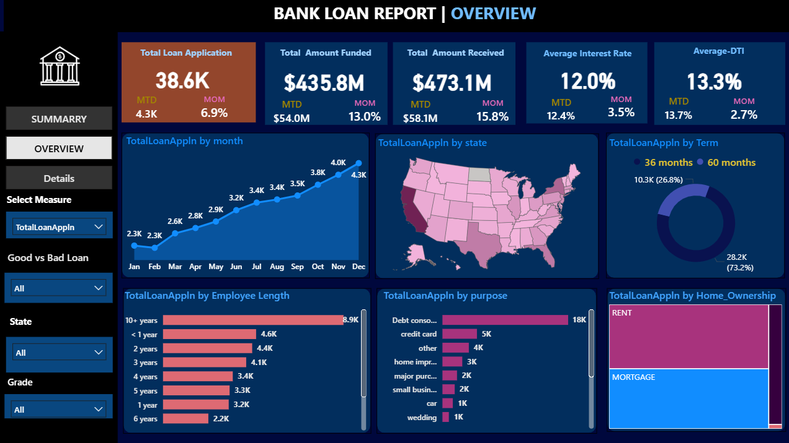
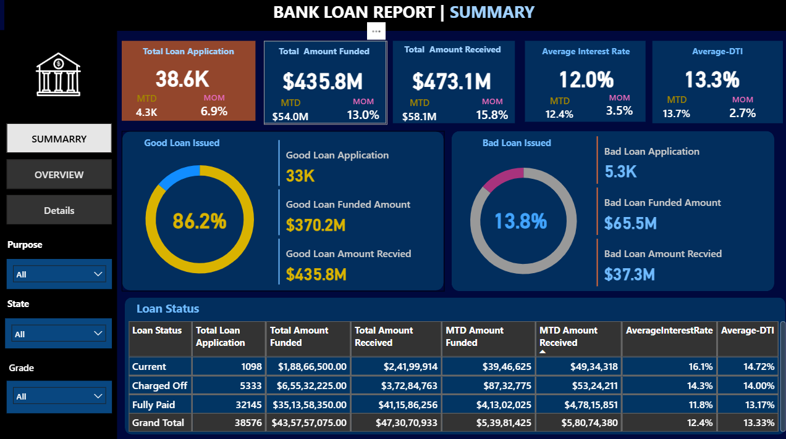
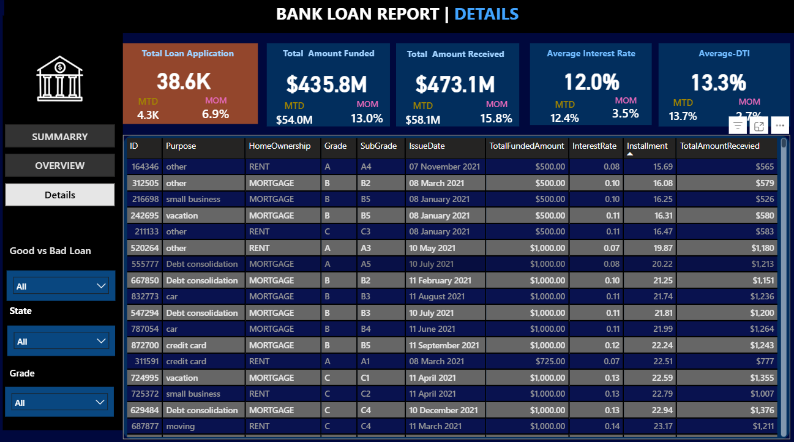

# Bank Loan Analysis | SQL, Excel, Power BI

An end-to-end analysis of **38,576 loan applications**: the data was validated with SQL and Excel, then turned into a 3-page Power BI report that tracks application volume, funding, repayment and loan quality (good vs bad loans).



## Business problem
A lending team needs one place to answer: *How many loans are we receiving and funding? How much is coming back? Which loans are performing well, and which are not?* This project builds that view and checks the data behind it before reporting.

## Dataset
| Item | Detail |
|---|---|
| Records | 38,576 loan applications (issued Jan–Dec 2021) |
| Coverage | 50 US states, 14 loan purposes |
| Key fields | loan amount, interest rate, DTI, term, grade, purpose, home ownership, employment length, loan status, total payment |
| File | [`data/financialloan.csv`](data/financialloan.csv) |

## Data validation (SQL + Excel)
- Confirmed **zero duplicate loan IDs** across all 38,576 records.
- Flagged **1,438 missing employment titles (3.7%)** so they would not be silently reported as complete.
- Cross-checked report totals against the raw data before building visuals.

## Key results
| KPI | Value |
|---|---|
| Total loan applications | 38.6K |
| Total funded amount | $435.8M |
| Total amount received | $473.1M |
| Average interest rate | 12.05% |
| Average DTI | 13.33% |
| Good loans (Fully Paid + Current) | **86.18%** |
| Bad loans (Charged Off) | 13.82% |

**What the data shows**
- Monthly applications grew steadily from **2,332 in January to 4,314 in December**.
- **Debt consolidation** is the largest loan purpose (about 18K applications).
- About **73% of loans are on 36-month terms**; 27% are on 60-month terms.
- Charged-off loans carry a higher average interest rate (13.9%) than fully paid loans (11.6%).

## Dashboard pages
1. **Summary:** headline KPIs with month-to-date (MTD) and month-over-month (MoM) change, good vs bad loan split and a loan status table.
2. **Overview:** monthly trend, state map, term, employment length, purpose and home ownership, with filters for measure, state and grade.
3. **Details:** full record-level grid for drill-down.

| Summary | Details |
|---|---|
|  |  |

## SQL used
Queries for every KPI (total applications, funded amount, amount received, average interest rate, average DTI, each with MTD and previous-month MTD), the good vs bad loan breakdown, and the chart views are documented in [`sql/bank_loan_sql_queries.docx`](sql/bank_loan_sql_queries.docx).

## Skills demonstrated
- SQL: aggregation, date functions, MTD/PMTD comparisons, conditional logic for good/bad loan classification
- Data validation and cleaning: duplicates and missing values
- Power BI: KPI cards, DAX measures, slicers, map, trend and breakdown charts, multi-page navigation
- Turning raw data into KPIs a business team can act on

## Repository structure
```
bank-loan-analysis/
├── data/          financialloan.csv
├── dashboard/     bank_loan_dashboard.pbit (Power BI template)
├── sql/           bank_loan_sql_queries.docx
├── screenshots/   dashboard images
└── README.md
```

## How to open the dashboard
Open the `.pbit` template in Power BI Desktop and, when prompted, point it to `data/financialloan.csv`.

## Contact
**Madhumitha Divate** | madhudivate28@gmail.com | Bengaluru, India
